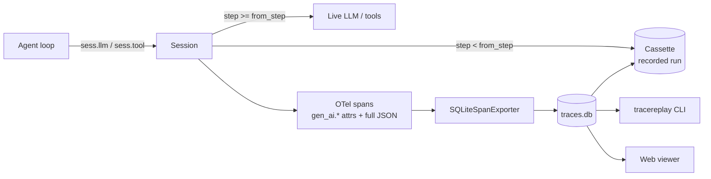

# llm-trace-replay

An OpenTelemetry-based flight recorder for LLM agents: every LLM call, tool call, full prompt context and token count becomes a span in a local SQLite store. A CLI and web viewer replay a run step by step, and any run can be **re-executed from any step** with the exact recorded context — earlier steps served from the recording, later steps live.

## What it is
- `Recorder` / `Session`: the agent calls `sess.llm(messages, **params)` and `sess.tool(name, args)`; each call is an OTel span with GenAI semantic-convention attributes (`gen_ai.request.model`, `gen_ai.usage.input_tokens`, `gen_ai.usage.output_tokens`, `gen_ai.tool.name`) plus the full request/response JSON.
- `SQLiteSpanExporter`: a standard OTel `SpanExporter`, so the same spans can also go to Jaeger/Tempo/Honeycomb with an extra processor.
- Replay: a recorded run is a cassette. Steps `< from_step` are served from it after a request-hash check (`Divergence` if the agent asks for something different); steps `>= from_step` run live and are recorded as a new run linked to its parent.
- `tracereplay` CLI (`demo`, `list`, `show`, `step`, `verify`, `rerun --from N`, `serve`) and a zero-dependency web viewer (stdlib `http.server`).

## Why
Agent traces (see `agent-13-serving-observability`) tell you *what* happened. Debugging needs more: rerun step 5 with a new prompt or model without paying for, or perturbing, steps 0-4; prove a fix by replaying the exact context; detect when code changes make an agent ask different questions than it did in production.

## Architecture


## How it works
```bash
pip install -e . pytest
tracereplay demo                      # record 10 demo tasks
tracereplay list
tracereplay show <run_id>             # step-by-step replay
tracereplay step <run_id> 4           # exact message list the LLM saw at step 4
tracereplay verify <run_id>           # full replay from cassette must reproduce the answer
tracereplay rerun <run_id> --from 4 --llm v2   # reuse steps 0-3, run live from 4
tracereplay serve                     # http://127.0.0.1:8765
```
The demo agent uses a **simulated LLM** (a deterministic policy that parses the conversation, no model weights) so results are reproducible offline; any chat model with the signature `(messages, **params) -> {"text", "usage", "model"}` plugs in unchanged. Token counts from the simulated LLM are whitespace word counts.

## Results
From [`results/replay_eval.json`](results/replay_eval.json) (`python -m scripts.replay_eval`, 10 demo tasks, simulated LLM, real OTel + SQLite path):

| Check | Result |
|---|---|
| Steps recorded | 72 (7.2 per run) |
| Full replay from cassette reproduces final answer, all steps from cassette | **10/10** |
| Re-execute from every step k (same policy) reproduces answer, exactly k steps reused | **72/72** |
| Re-execute from the calc step with policy v2 (rounds ratios) | answers changed on the 3 ratio tasks only, 4 steps reused each |
| Divergence detected when the task text is edited and replayed against the old cassette | **3/3** |
| Mean wall time per run, bare loop vs recorded | 0.089 ms vs 6.421 ms (SimpleSpanProcessor + SQLite commit per span) |

The overhead figure is per run of a microsecond-scale simulated agent, so it is almost all SQLite I/O; with a real LLM call (hundreds of ms) it is small in relative terms, but this repo did not measure that.

## Tests
16 tests (`pytest -q`): span/step structure, GenAI attributes, single trace with parented spans, exact context at a step, full replay with zero live calls, rerun from steps 0/3/6 with correct cassette/live split, parent linking, model swap changes downstream only, divergence, hash stability, CLI end to end, web viewer API, persistence across processes, cassette as source of truth.

## Limits
- Demo LLM is simulated; no real-model run is in the committed results.
- Replay is exact only if the agent's control flow is a function of its LLM/tool I/O; hidden state (clocks, randomness, globals) must also go through `sess.tool`.
- `SimpleSpanProcessor` writes synchronously; use `BatchSpanProcessor` for production volume.
- Streaming responses and parallel tool calls are recorded as single spans, not token-level events.
- `calc` in the demo uses a restricted `eval`; demo only.

## License
MIT
